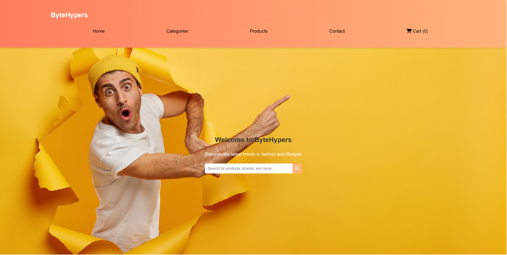

# 🛍️ ByteHypers: E-commerce Storefront UI

A front-end storefront for a fashion e-commerce site, built with **HTML**, **CSS** and **JavaScript**.

🔗 **Live demo:** https://e-commersbytehyper.netlify.app/

## Features
- Landing hero ("Welcome to ByteHypers")
- **Shop by categories**: Men, Women, Kids, Accessories
- **Product grid** with product cards
- Responsive layout and a little JavaScript interactivity

## Run it
Open `index.html` in a browser, or visit the live demo.

## Tech
HTML · CSS · JavaScript · deployed on Netlify
